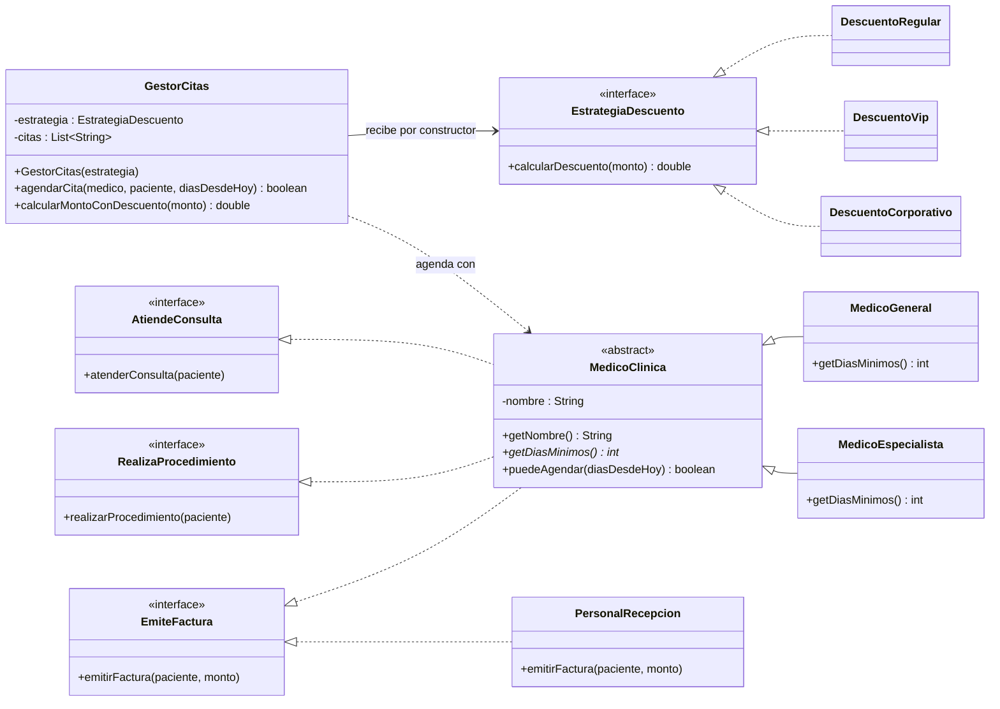
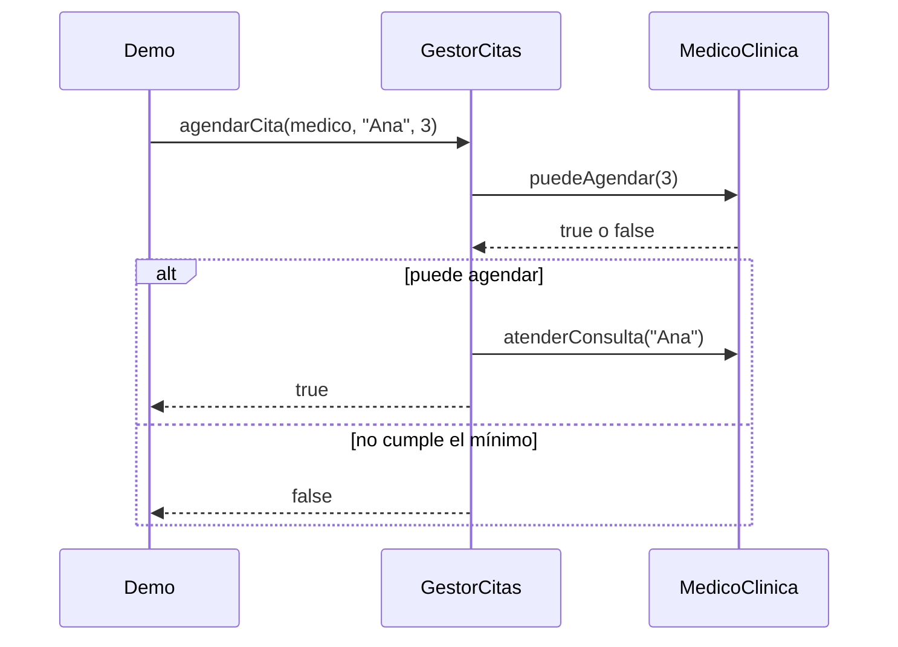

# 🗺️ Taller 01 — Diagrama de clases de referencia

> 👩‍🏫 **Material docente.** Muestra una forma posible de resolver el [Taller 01](taller-01.md). Los nombres de clases y métodos son una **sugerencia**: el taller solo fija `EstrategiaDescuento`, `GestorCitas`, `MedicoClinica` y los métodos `agendarCita`, `puedeAgendar`, `getNombre`, `atenderConsulta` y `calcularMontoConDescuento`. No se entrega a los estudiantes antes de resolver el taller.

## 🧭 El diagrama

## 📖 Cómo leerlo

| Símbolo | Significa | Ejemplo |
|---|---|---|
| `<\|..` (flecha punteada con triángulo) | **Implementa** una interfaz | `DescuentoVip` implementa `EstrategiaDescuento` |
| `<\|--` (flecha continua con triángulo) | **Hereda** de una clase | `MedicoGeneral` hereda de `MedicoClinica` |
| `-->` | **Tiene** una pieza (la guarda como campo) | `GestorCitas` guarda una `EstrategiaDescuento` |
| `..>` | **Usa** una clase de paso | `GestorCitas` usa un `MedicoClinica` en `agendarCita` |
| `<<interface>>` / `<<abstract>>` | Tipo de clase | — |
| `+` / `-` | Público / privado | — |

## 🧩 Dónde está cada principio

| Principio | Qué se ve en el diagrama |
|---|---|
| **SRP** | `GestorCitas` solo agenda. El descuento, la atención y la factura están en otras clases. |
| **DIP** | `GestorCitas` depende de la **interfaz** `EstrategiaDescuento`, no de `DescuentoVip` ni de otra clase concreta. La recibe por constructor. |
| **OCP** | `DescuentoCorporativo` se agrega como una clase nueva. No cambia ninguna otra caja del diagrama. |
| **LSP** | Todos los médicos se usan como `MedicoClinica`. Cada subclase solo informa su mínimo con `getDiasMinimos()`. Nadie sobrescribe `puedeAgendar`. |
| **ISP** | Tres interfaces pequeñas, una por capacidad. `PersonalRecepcion` implementa solo `EmiteFactura`. |

## 🔎 Una cita, paso a paso

1. `Demo` pide a `GestorCitas` agendar una cita.
2. `GestorCitas` pregunta al médico si cumple el mínimo de días: `puedeAgendar`. Quien decide es el médico, porque cada tipo informa su propio mínimo.
3. Si cumple, `GestorCitas` guarda la cita y delega la atención al médico. Si no, devuelve `false`.
4. El monto se calcula aparte, con `calcularMontoConDescuento`, que usa la estrategia recibida.

> 💡 `PersonalRecepcion` es un ejemplo de rol que no atiende ni hace procedimientos. Es la razón por la que `EmiteFactura`, `AtiendeConsulta` y `RealizaProcedimiento` son interfaces separadas: si fueran una sola, recepción tendría que implementar métodos que no le corresponden.
