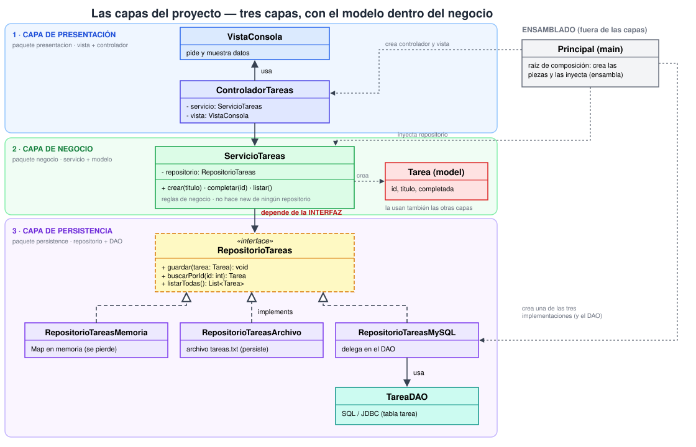

# 🔁 Guía de repaso — Interfaces, capas e inyección de dependencias

## 🎯 Objetivo

Entender, con un programa pequeño y **completo que se puede ejecutar**, tres ideas que
sostienen el proyecto final: **interfaz**, **separación en capas** e **inyección de
dependencias**. Al terminar, deberías poder explicar por qué cambiar *dónde* se guardan
los datos no obliga a tocar la lógica del programa.

## 🌍 Contexto

El ejemplo es una **lista de tareas por consola**: crear tareas, listarlas y marcarlas
como completadas. Es deliberadamente simple para que el foco esté en la estructura, no
en el problema.

Hay una decisión que puede cambiar: **dónde se guardan las tareas**. Primero en memoria
(rápido, se pierde al cerrar), después en un archivo (persiste) y por último en una
base de datos MySQL. Si la lógica supiera
*cómo* se guarda, cada cambio obligaría a reescribirla. La interfaz evita eso.

## 🧠 Las tres ideas en una frase

| Idea | En una frase | En el ejemplo |
|---|---|---|
| **Interfaz** | Un contrato: lista de operaciones, sin código | `RepositorioTareas` |
| **Separación de capas** | Tres capas (presentación, negocio, persistencia), con el modelo dentro de negocio: cada capa conoce solo a la de abajo | Controlador → Servicio → Repositorio → DAO |
| **Inyección de dependencias** | Una clase **recibe** lo que necesita; no lo crea con `new` | `new ServicioTareas(repositorio)` |

## 📚 Conceptos

<details>
<summary><strong>📖 Ver los conceptos: inyección de dependencias, interfaces, polimorfismo e inversión de dependencias</strong> (clic para desplegar)</summary>

Cada concepto se despliega por separado (clic en el título).

<details>
<summary><strong>💉 Inyección de dependencias</strong> (clic para desplegar)</summary>

**Dependencia** es cualquier objeto que una clase necesita para hacer su trabajo. El
`ServicioTareas` necesita algo que guarde tareas: esa es su dependencia.

Hay dos formas de conseguirla:

| | Cómo la consigue | Ejemplo |
|---|---|---|
| ❌ **Crearla ella misma** | La clase hace `new` por dentro | `private final RepositorioTareasArchivo repo = new RepositorioTareasArchivo("tareas.txt");` |
| ✅ **Recibirla** (inyección) | Alguien de afuera se la entrega por el constructor | `public ServicioTareas(RepositorioTareas repositorio)` |

**Inyectar es "recibir en vez de crear".** Pensalo como un enchufe: el electrodoméstico
(el servicio) no fabrica su propia electricidad; se conecta a lo que le den. Quien lo
conecta (`Principal`) decide si es una fuente u otra.

En el ejemplo, la inyección pasa en una sola línea de `Principal`:

```java
ServicioTareas servicio = new ServicioTareas(repositorio);   // aquí se inyecta
```

**¿Por qué sirve?** Porque la clase deja de decidir con *quién* trabaja. Eso permite
cambiar la dependencia (o usar una de prueba) sin modificar la clase.

</details>

<details>
<summary><strong>📜 Interfaces: para qué se usan</strong> (clic para desplegar)</summary>

Una **interfaz** es un contrato: una lista de operaciones **sin código**. Dice *qué* se
puede hacer, no *cómo*.

```java
public interface RepositorioTareas {
    void guardar(Tarea tarea);
    Tarea buscarPorId(int id);
    List<Tarea> listarTodas();
}
```

Analogía: un enchufe de pared. Define la forma (dos clavijas), pero no le importa si
detrás hay una central hidroeléctrica o un panel solar. Cualquier aparato que respete la
forma, funciona.

**Para qué se usa:**

1. **Separar capas.** El servicio y el repositorio quedan conectados solo por el
   contrato. Cada capa puede cambiar por dentro sin romper a la otra.
2. **Poder cambiar la implementación.** Memoria hoy, archivo mañana, MySQL
   después: el servicio no se entera.
3. **Poder probar sin cosas pesadas.** Se prueba el servicio con la versión en memoria,
   sin archivos ni bases de datos (ver `Prueba.java`).
4. **Trabajar en equipo.** Una persona escribe el servicio contra el contrato mientras
   otra escribe el repositorio; se juntan al final.
5. **Dejar claro qué se espera.** Si una clase dice `implements RepositorioTareas`, el
   compilador la obliga a tener los tres métodos.
6. **Aplicar la inversión de dependencias.** Es una de sus funciones principales: el
   servicio (alto nivel) y las implementaciones (bajo nivel) dependen de la **interfaz**, no
   unos de otros. Así el detalle técnico se adapta al contrato y no al revés (ver el
   desplegable *Inversión de dependencias*).

**Regla práctica:** creá una interfaz cuando hay (o habrá) **más de una forma** de hacer
algo, o cuando querés **separar una capa de otra**. No hace falta una interfaz por cada clase.

</details>

<details>
<summary><strong>🎭 Polimorfismo: ¿se usa en este ejemplo? Sí</strong> (clic para desplegar)</summary>

**Polimorfismo** significa "muchas formas": usar una referencia del tipo del contrato y
que el comportamiento real dependa del objeto que haya detrás.

En `ServicioTareas`:

```java
private final RepositorioTareas repositorio;   // tipo = interfaz

repositorio.guardar(tarea);                    // ¿qué guardar() se ejecuta?
```

La línea `repositorio.guardar(tarea)` es **la misma** siempre, pero lo que hace cambia:

| `repositorio` apunta a… | `guardar(tarea)` hace… |
|---|---|
| `RepositorioTareasMemoria` | Mete la tarea en un `Map` |
| `RepositorioTareasArchivo` | Escribe una línea en `tareas.txt` |
| `RepositorioTareasMySQL` | Delega en `TareaDAO`, que ejecuta un `INSERT` / `UPDATE` |

Java decide **en tiempo de ejecución** cuál método llamar, según el objeto real. El
servicio no pregunta "¿eres de memoria o de archivo?": simplemente llama al método y cada
implementación responde a su manera. Eso es polimorfismo.

> 🧩 **Cómo se relacionan los tres conceptos**
>
> - La **interfaz** crea el contrato.
> - El **polimorfismo** permite que distintas clases cumplan ese contrato de distinta forma.
> - La **inyección de dependencias** es lo que decide, desde afuera, cuál de esas clases
>   recibe el servicio.

</details>

<details>
<summary><strong>🔄 Inversión de dependencias (DIP)</strong> (clic para desplegar)</summary>

### 🧠 La idea

Es la **D** de SOLID: *los módulos de alto nivel no deben depender de los de bajo nivel;
ambos deben depender de abstracciones*.

- **Alto nivel** = lo que contiene las reglas del negocio (`ServicioTareas`).
- **Bajo nivel** = los detalles técnicos (archivo, memoria, MySQL).
- **Abstracción** = la interfaz (`RepositorioTareas`).

Lo "invertido" es la **flecha**. Sin la regla, lo natural es que el servicio dependa de lo
que usa; con la regla, el detalle pasa a depender del contrato que define el servicio.

```
❌ Sin inversión                          ✅ Con inversión

ServicioTareas                            ServicioTareas
      │ depende de                              │ depende de
      ▼                                         ▼
RepositorioTareasArchivo                  «interface» RepositorioTareas
                                                ▲ implements
                                                │
                                          RepositorioTareasArchivo
```

### ❌ Antes: el servicio depende del detalle

```java
import com.tareas.persistence.repository.RepositorioTareasArchivo;   // 👈 importa la clase concreta

public class ServicioTareas {
    private final RepositorioTareasArchivo repositorio = new RepositorioTareasArchivo("tareas.txt");
}
```

Si mañana se guarda en MySQL, hay que **editar el servicio**: la regla de negocio cambió
solo porque cambió un detalle técnico.

### ✅ Después: ambos dependen de la interfaz

```java
// Alto nivel: depende de la abstracción
public class ServicioTareas {
    private final RepositorioTareas repositorio;          // 👈 interfaz, sin import de ninguna clase concreta
    public ServicioTareas(RepositorioTareas repositorio) { this.repositorio = repositorio; }
}

// Bajo nivel: también depende de la abstracción (la implementa)
public class RepositorioTareasMySQL implements RepositorioTareas { /* ... */ }
```

Mirá los `import` de `ServicioTareas`: **no aparece ninguna clase concreta**. Esa es la
señal de que la dependencia está invertida.

### 🤝 ¿Y la inyección de dependencias? No son lo mismo

| | Inversión de dependencias | Inyección de dependencias |
|---|---|---|
| **Qué es** | Un **principio de diseño** (la D de SOLID) | Una **técnica** para aplicarlo |
| **Responde a** | ¿De **qué** debe depender una clase? → de una abstracción | ¿**Cómo** consigue esa clase su dependencia? → se la entregan |
| **Dónde se ve** | El **tipo** del campo: `RepositorioTareas` | El **constructor** y `new ServicioTareas(repositorio)` |
| **Sin la otra** | La clase no sabe qué objeto usar | La clase recibe un objeto pero sigue atada a una clase concreta |

Las dos juntas, en este ejemplo:

```java
// Principal.java
RepositorioTareas repositorio = new RepositorioTareasMySQL(new TareaDAO(url, usuario, clave));
//  └─ tipo = INTERFAZ   → Inversión: nadie queda atado a MySQL

ServicioTareas servicio = new ServicioTareas(repositorio);
//                                           └─ se ENTREGA por constructor → Inyección
```

- **Inversión** → `ServicioTareas` declara que necesita un `RepositorioTareas` (abstracción).
- **Inyección** → `Principal` es quien decide cuál y se lo entrega.

> 💡 Se puede **inyectar sin invertir** (`new ServicioTareas(new RepositorioTareasArchivo(...))`
> con un constructor que pide la clase concreta) e **invertir sin inyectar** (usar la
> interfaz pero con un `new` dentro). Solo juntas dan el desacoplamiento completo.

> 🔗 **Dónde verlo en el ejemplo**
>
> - [`ServicioTareas`](ejemplo-capas/src/com/tareas/negocio/service/ServicioTareas.java) — campo de tipo interfaz, sin imports concretos.
> - [`RepositorioTareasMySQL`](ejemplo-capas/src/com/tareas/persistence/repository/RepositorioTareasMySQL.java) — el detalle que implementa el contrato.
> - [`Principal`](ejemplo-capas/src/com/tareas/Principal.java) — la inyección.
> - [Paso 0](ejemplo-capas/antes/ServicioAcoplado.java) — el caso sin inversión.

</details>

<details>
<summary><strong>🧩 Otros conceptos que se ven en el ejemplo</strong> (clic para desplegar)</summary>

- **Encapsulamiento:** los campos son `private` y se accede por métodos.
- **Responsabilidad única:** cada clase hace una sola cosa (la vista muestra, el
  servicio aplica reglas, el repositorio guarda).
- **Inversión de dependencias:** tiene su propio desplegable, arriba.

</details>

</details>

## 🧱 Las capas del proyecto

La arquitectura es una **arquitectura en capas**: tres capas apiladas. Cada capa solo
habla con la de abajo. El modelo (`Tarea`) vive dentro de la capa de negocio.

| Capa | Paquete | Clases | Responsabilidad |
|---|---|---|---|
| **1 · Presentación** | `presentacion.vista` | `VistaConsola` | Pide y muestra datos |
| | `presentacion.controlador` | `ControladorTareas` | Traduce las acciones del usuario en llamadas al servicio |
| **2 · Negocio** | `negocio.service` | `ServicioTareas` | Reglas de negocio |
| | `negocio.model` | `Tarea` | Los datos del dominio; las otras capas también la usan |
| **3 · Persistencia** | `persistence.repository` | `RepositorioTareas` (interfaz) + `Memoria`, `Archivo`, `MySQL` | El contrato de guardado y sus formas de cumplirlo |
| | `persistence.dao` | `TareaDAO` | El acceso de bajo nivel a la base de datos (SQL / JDBC) |

> 🧭 **¿Es MVC?** No del todo. MVC separa Modelo, Vista y Controlador; aquí esa tríada vive
> **dentro** de la capa de presentación, y además hay negocio y persistencia por debajo. El
> modelo forma parte del negocio (es el corazón del dominio), aunque la presentación y la
> persistencia también importan `Tarea` para mostrarla y guardarla.

**¿Repositorio y DAO no son lo mismo?** No. El **repositorio** habla el idioma del
negocio ("guardar una tarea") y es lo que ve el servicio. El **DAO** habla el idioma de la
base de datos (`INSERT`, `ResultSet`, conexiones). `RepositorioTareasMySQL` cumple el
contrato y le **delega** el SQL a `TareaDAO`; así el SQL vive en un solo lugar.



<details>
<summary><strong>🧭 Cómo leer las líneas del diagrama</strong> (clic para desplegar)</summary>

| Línea | Qué significa | En el diagrama |
|---|---|---|
| **Continua con flecha** (→) | **Dependencia fuerte**: la clase de origen **guarda** a la otra como campo. | `ControladorTareas` → `VistaConsola` y `ServicioTareas`; `ServicioTareas` → `RepositorioTareas`; `RepositorioTareasMySQL` → `TareaDAO` |
| **Punteada con flecha abierta** (⇢) | **Dependencia débil (uso)**: la clase **crea, recibe o usa** a la otra, pero no la guarda como campo. | `ServicioTareas` ⇢ `Tarea` (la crea); `Principal` ⇢ controlador, servicio, repositorio y DAO (los crea o inyecta) |
| **Punteada con triángulo vacío** (⇢▷) | **Implementación** (`implements`): la clase cumple el contrato de la interfaz. | `RepositorioTareasMemoria`, `RepositorioTareasArchivo` y `RepositorioTareasMySQL` ⇢▷ `RepositorioTareas` |

La flecha siempre apunta **hacia la clase de la que se depende**: si `ControladorTareas`
tiene un campo `VistaConsola`, la flecha sale del controlador y llega a la vista. La vista
no sabe que el controlador existe, por eso no hay flecha en el otro sentido.

</details>

La flecha que importa: el servicio apunta a la **interfaz**, nunca a una clase concreta.
Las implementaciones también apuntan a la interfaz (la implementan). Por eso se llama
**inversión de dependencias**: el detalle depende del contrato, no al revés.

> ▶️ **Todo el código de esta guía se puede ejecutar**: ver [ejemplo-capas/](ejemplo-capas/README.md)
> y la sección [📦 Proyecto completo](#-proyecto-completo-para-llevar-a-visual-studio-code).

## 0️⃣ Paso 0 — El problema: el servicio acoplado

```java
public class ServicioAcoplado {
    private final AlmacenArchivo almacen = new AlmacenArchivo();   // ❌ new dentro del servicio

    void crear(String titulo) { almacen.guardar(titulo); }
}
```

El servicio **crea** su dependencia. Queda atado al archivo: para guardar en memoria hay
que editar el servicio, y para probarlo hay que tocar un archivo real.

## 1️⃣ Paso 1 — El contrato (la interfaz)

Archivo: `persistence/repository/RepositorioTareas.java`

```java
package com.tareas.persistence.repository;

import com.tareas.negocio.model.Tarea;
import java.util.List;

/** Paso 1 — El contrato: solo firmas. Dice QUÉ se puede hacer, no CÓMO. */
public interface RepositorioTareas {
    void guardar(Tarea tarea);          // crea la tarea o reemplaza la que tenga el mismo id
    Tarea buscarPorId(int id);          // null si no existe
    List<Tarea> listarTodas();
}
```

Solo firmas. Sin `{ }` de código, sin `Map`, sin archivos. Dice **qué** se puede hacer.

## 2️⃣ Paso 2 — Tres implementaciones del mismo contrato

```java
package com.tareas.persistence.repository;

import com.tareas.negocio.model.Tarea;
import java.util.ArrayList;
import java.util.LinkedHashMap;
import java.util.List;
import java.util.Map;

/** Paso 2a — Guarda en memoria: al cerrar el programa se pierde todo. */
public class RepositorioTareasMemoria implements RepositorioTareas {

    private final Map<Integer, Tarea> tareas = new LinkedHashMap<>();

    @Override
    public void guardar(Tarea tarea) { tareas.put(tarea.getId(), tarea); }

    @Override
    public Tarea buscarPorId(int id) { return tareas.get(id); }

    @Override
    public List<Tarea> listarTodas() { return new ArrayList<>(tareas.values()); }
}
```

```java
package com.tareas.persistence.repository;

import com.tareas.negocio.model.Tarea;
import java.io.IOException;
import java.io.UncheckedIOException;
import java.nio.charset.StandardCharsets;
import java.nio.file.Files;
import java.nio.file.Path;
import java.util.ArrayList;
import java.util.LinkedHashMap;
import java.util.List;
import java.util.Map;

/** Paso 2b — Guarda en un archivo de texto: sobrevive entre ejecuciones. Formato: id;completada;titulo */
public class RepositorioTareasArchivo implements RepositorioTareas {

    private final Path archivo;

    public RepositorioTareasArchivo(String rutaArchivo) {
        this.archivo = Path.of(rutaArchivo);
    }

    @Override
    public void guardar(Tarea tarea) {
        Map<Integer, Tarea> todas = leer();
        todas.put(tarea.getId(), tarea);
        escribir(todas);
    }

    @Override
    public Tarea buscarPorId(int id) { return leer().get(id); }

    @Override
    public List<Tarea> listarTodas() { return new ArrayList<>(leer().values()); }

    private Map<Integer, Tarea> leer() {
        Map<Integer, Tarea> tareas = new LinkedHashMap<>();
        if (!Files.exists(archivo)) return tareas;
        try {
            for (String linea : Files.readAllLines(archivo, StandardCharsets.UTF_8)) {
                String[] partes = linea.split(";", 3);
                int id = Integer.parseInt(partes[0]);
                tareas.put(id, new Tarea(id, partes[2], Boolean.parseBoolean(partes[1])));
            }
        } catch (IOException e) {
            throw new UncheckedIOException(e);
        }
        return tareas;
    }

    private void escribir(Map<Integer, Tarea> tareas) {
        List<String> lineas = new ArrayList<>();
        for (Tarea t : tareas.values()) {
            lineas.add(t.getId() + ";" + t.isCompletada() + ";" + t.getTitulo());
        }
        try {
            Files.write(archivo, lineas, StandardCharsets.UTF_8);
        } catch (IOException e) {
            throw new UncheckedIOException(e);
        }
    }
}
```

Mismo contrato, **cómo** distinto: una usa un `Map`, la otra lee y escribe `tareas.txt`.
El compilador exige que cumplan todos los métodos de la interfaz.

**Paso 2c — MySQL con DAO.** La tercera implementación no escribe SQL: recibe un
`TareaDAO` y le delega. El DAO es el único que conoce JDBC.

```java
public class RepositorioTareasMySQL implements RepositorioTareas {
    private final TareaDAO dao;
    public RepositorioTareasMySQL(TareaDAO dao) { this.dao = dao; }

    @Override public void guardar(Tarea tarea) { dao.guardar(tarea); }
    // buscarPorId y listarTodas delegan igual (código completo más abajo)
}
```

## 3️⃣ Paso 3 — El servicio depende de la interfaz

Archivo: `negocio/service/ServicioTareas.java`

```java
package com.tareas.negocio.service;

import com.tareas.negocio.model.Tarea;
import com.tareas.persistence.repository.RepositorioTareas;
import java.util.List;

/** Paso 3 — Reglas de negocio. Depende de la INTERFAZ y la recibe por constructor. */
public class ServicioTareas {

    private final RepositorioTareas repositorio;   // tipo = interfaz, nunca una clase concreta

    public ServicioTareas(RepositorioTareas repositorio) {
        this.repositorio = repositorio;            // lo RECIBE, no hace new
    }

    public Tarea crear(String titulo) {
        if (titulo == null || titulo.isBlank()) {
            throw new IllegalArgumentException("El título no puede estar vacío");
        }
        Tarea tarea = new Tarea(siguienteId(), titulo.trim(), false);
        repositorio.guardar(tarea);
        return tarea;
    }

    public Tarea completar(int id) {
        Tarea tarea = repositorio.buscarPorId(id);
        if (tarea == null) {
            throw new IllegalArgumentException("No existe la tarea " + id);
        }
        tarea.marcarCompletada();
        repositorio.guardar(tarea);
        return tarea;
    }

    public List<Tarea> listar() {
        return repositorio.listarTodas();
    }

    private int siguienteId() {
        int mayor = 0;
        for (Tarea t : repositorio.listarTodas()) {
            mayor = Math.max(mayor, t.getId());
        }
        return mayor + 1;
    }
}
```

Fijate en dos detalles:

- El campo es de tipo `RepositorioTareas`, **no** `RepositorioTareasArchivo`.
- No hay ningún `new RepositorioTareas...()` dentro del servicio. Si lo hubiera,
  quedaría atado a esa implementación para siempre.

## 4️⃣ Paso 4 — Alguien lo conecta (la inyección)

Archivo: `Principal.java`, el único lugar que sabe qué implementación se usa. Esta es la
clase **completa**, para ver cómo se integran todas las capas:

```java
package com.tareas;

import com.tareas.presentacion.controlador.ControladorTareas;
import com.tareas.persistence.dao.TareaDAO;
import com.tareas.persistence.repository.RepositorioTareas;
import com.tareas.persistence.repository.RepositorioTareasArchivo;
import com.tareas.persistence.repository.RepositorioTareasMemoria;
import com.tareas.persistence.repository.RepositorioTareasMySQL;
import com.tareas.negocio.service.ServicioTareas;
import com.tareas.presentacion.vista.VistaConsola;

/**
 * Paso 4 — El ÚNICO lugar que sabe qué implementación se usa (la inyección).
 *
 * Uso: java com.tareas.Principal [archivo | memoria | mysql]      (por defecto: archivo)
 * Para mysql: variables de entorno TAREAS_DB_URL, TAREAS_DB_USER, TAREAS_DB_PASS
 * y el conector de MySQL en el classpath.
 */
public class Principal {

    public static void main(String[] args) {
        String modo = args.length > 0 ? args[0] : "archivo";

        // 1) Se elige y se CREA la implementación (lo más profundo, primero)
        RepositorioTareas repositorio = switch (modo) {
            case "memoria" -> new RepositorioTareasMemoria();
            case "mysql" -> new RepositorioTareasMySQL(new TareaDAO(
                    System.getenv().getOrDefault("TAREAS_DB_URL", "jdbc:mysql://localhost:3306/tareas"),
                    System.getenv().getOrDefault("TAREAS_DB_USER", "root"),
                    System.getenv().getOrDefault("TAREAS_DB_PASS", "")));
            default -> new RepositorioTareasArchivo("tareas.txt");
        };
        System.out.println("Guardando con: " + repositorio.getClass().getSimpleName());

        // 2) Se INYECTA en el servicio (el servicio solo ve la interfaz)
        ServicioTareas servicio = new ServicioTareas(repositorio);

        // 3) Se inyecta el servicio en el controlador, junto con la vista
        ControladorTareas controlador = new ControladorTareas(servicio, new VistaConsola());

        // 4) Arranca la aplicación
        controlador.iniciar();
    }
}
```

### 🔍 Cómo se integra

| Pieza | Qué hace | Qué sabe de las demás |
|---|---|---|
| `new RepositorioTareasArchivo(...)` / `Memoria()` / `MySQL(new TareaDAO(...))` | **Crea** la implementación (y el DAO, si hace falta) | Es la única clase que las nombra |
| `new ServicioTareas(repositorio)` | **Inyecta**: entrega la dependencia al constructor | El servicio solo ve la interfaz |
| `new ControladorTareas(servicio, new VistaConsola())` | Conecta controlador, servicio y vista | El controlador no conoce el repositorio |
| `controlador.iniciar()` | Arranca el menú | — |

El orden de armado va **de abajo hacia arriba** (repositorio → servicio → controlador).
En ejecución, el controlador es quien dirige: pide datos a la vista, llama al servicio y
este al repositorio. La vista nunca conoce al controlador.

**Eso es inyectar**: el `main` crea la dependencia y se la entrega al constructor.
Para cambiar el almacenamiento solo cambia la creación del repositorio en `Principal`:

```java
RepositorioTareas repositorio = new RepositorioTareasMemoria();   // antes: ...Archivo("tareas.txt")
ServicioTareas servicio = new ServicioTareas(repositorio);        // esta línea no cambia
```

`ServicioTareas` no se toca. No se vuelve a probar su lógica: no se enteró del cambio.

## ❌ Antes y ✅ después

```java
// ❌ Acoplado: el servicio crea su propia dependencia
public class ServicioTareas {
    private final RepositorioTareasArchivo repositorio = new RepositorioTareasArchivo("tareas.txt");
}

// ✅ Desacoplado: el servicio recibe un contrato
public class ServicioTareas {
    private final RepositorioTareas repositorio;
    public ServicioTareas(RepositorioTareas repositorio) {
        this.repositorio = repositorio;
    }
}
```

| | ❌ Acoplado | ✅ Con interfaz + inyección |
|---|---|---|
| Cambiar archivo por memoria | Editar el servicio | Cambiar una línea del `main` |
| Probar el servicio sin tocar archivos | Imposible | Inyectar la versión en memoria |
| Quién decide la implementación | La propia clase | El que ensambla (`main`) |

## 🧪 Beneficio práctico: probar sin archivos ni menú

```java
import com.tareas.persistence.repository.RepositorioTareas;
import com.tareas.persistence.repository.RepositorioTareasMemoria;
import com.tareas.negocio.service.ServicioTareas;

/**
 * Prueba del servicio SIN archivos ni menú: se inyecta la versión en memoria.
 * Ejecutar (con out/ ya compilado):  javac -cp out -d out Prueba.java && java -cp out Prueba
 */
public class Prueba {

    public static void main(String[] args) {
        RepositorioTareas repositorio = new RepositorioTareasMemoria();
        ServicioTareas servicio = new ServicioTareas(repositorio);

        servicio.crear("Estudiar interfaces");
        servicio.crear("Hacer el ejercicio");
        servicio.completar(1);

        servicio.listar().forEach(System.out::println);
        System.out.println(servicio.listar().size() == 2 ? "OK: 2 tareas" : "FALLO");

        try {
            servicio.crear("   ");
            System.out.println("FALLO: debió rechazar el título vacío");
        } catch (IllegalArgumentException e) {
            System.out.println("OK: " + e.getMessage());
        }
    }
}
```

La prueba usa la versión en memoria: no crea `tareas.txt` y el servicio es el mismo que
usa la aplicación real.

> 🔗 **Ejemplos de este concepto en el proyecto final**
>
> - `service/EstrategiaCosto.java` — la interfaz es el contrato de cálculo; hay dos
>   implementaciones (`EstrategiaCostoConsultaGeneral`, `EstrategiaCostoConsultaEspecialista`).
> - `repository/RepositorioPacientes.java` — mismo esquema que `RepositorioTareas`, con
>   versión en memoria y versión DAO (`PacienteDAO`).
> - `notificacion/ObservadorCita.java` — el servicio avisa a "alguien" sin saber a quién.
> - `Principal.java` — el ensamblado completo: crea los DAO y los inyecta en los servicios.

## 📦 Proyecto completo para llevar a Visual Studio Code

Todo el código de la guía en un proyecto que compila y corre, sin dependencias externas.
Existe también una copia lista en [ejemplo-capas/](ejemplo-capas/README.md).

### 🌳 Árbol de archivos

```
ejemplo-capas/
├── Prueba.java                                  ← prueba sin menú ni archivos
├── antes/
│   └── ServicioAcoplado.java                    ← Paso 0: el ❌ acoplado
└── src/
    └── com/
        └── tareas/
            ├── Principal.java                   ← Paso 4: ensambla e inyecta
            ├── presentacion/                    ← 1 · capa de presentación
            │   ├── vista/
            │   │   └── VistaConsola.java        ← pide y muestra
            │   └── controlador/
            │       └── ControladorTareas.java   ← coordina vista y servicio
            ├── negocio/                         ← 2 · capa de negocio
            │   ├── model/
            │   │   └── Tarea.java               ← el modelo
            │   └── service/
            │       └── ServicioTareas.java      ← Paso 3: reglas de negocio
            └── persistence/                     ← 3 · capa de persistencia
                ├── dao/
                │   └── TareaDAO.java            ← Paso 2c: el SQL (JDBC)
                └── repository/
                    ├── RepositorioTareas.java           ← Paso 1: contrato «interface»
                    ├── RepositorioTareasMemoria.java    ← Paso 2a
                    ├── RepositorioTareasArchivo.java    ← Paso 2b
                    └── RepositorioTareasMySQL.java      ← Paso 2c (usa TareaDAO)
```

### 🛠️ Cómo armarlo en VS Code

1. Instalá el **Extension Pack for Java** y tené un JDK 17 o superior.
2. Creá la carpeta `ejemplo-capas/` y abrila con *File → Open Folder*.
3. Creá cada archivo con la **ruta exacta** del árbol (el `package` de cada archivo
   debe coincidir con su carpeta) y pegá el código de abajo.
4. Desde la terminal de VS Code, parado en `ejemplo-capas/`:

```bash
mkdir out
javac -encoding UTF-8 -d out $(find src -name '*.java')
java -cp out com.tareas.Principal archivo      # archivo | memoria
```

   O abrí `Principal.java` y pulsá **▶ Run** sobre el `main`. Menú: `1` crear,
   `2` listar, `3` completar, `0` salir.

> 🔎 **Para analizarlo**
> - Ejecutá con `archivo`, creá dos tareas, salí y volvé a entrar: siguen ahí
>   (mirá el `tareas.txt` que aparece). Con `memoria` desaparecen.
> - Poné un punto de interrupción en `ServicioTareas.crear` y usá *Debug*: verás que
>   `repositorio` apunta a una clase u otra según el argumento, sin que el servicio cambie.

### 📄 Código de cada archivo

#### `src/com/tareas/negocio/model/Tarea.java` — Modelo

```java
package com.tareas.negocio.model;

public class Tarea {

    private final int id;
    private final String titulo;
    private boolean completada;

    public Tarea(int id, String titulo, boolean completada) {
        this.id = id;
        this.titulo = titulo;
        this.completada = completada;
    }

    public int getId() { return id; }
    public String getTitulo() { return titulo; }
    public boolean isCompletada() { return completada; }

    public void marcarCompletada() { this.completada = true; }

    @Override
    public String toString() {
        return (completada ? "[x] " : "[ ] ") + id + " - " + titulo;
    }
}
```

#### `src/com/tareas/persistence/repository/RepositorioTareas.java` — Paso 1 — el contrato

```java
package com.tareas.persistence.repository;

import com.tareas.negocio.model.Tarea;
import java.util.List;

/** Paso 1 — El contrato: solo firmas. Dice QUÉ se puede hacer, no CÓMO. */
public interface RepositorioTareas {
    void guardar(Tarea tarea);          // crea la tarea o reemplaza la que tenga el mismo id
    Tarea buscarPorId(int id);          // null si no existe
    List<Tarea> listarTodas();
}
```

#### `src/com/tareas/persistence/repository/RepositorioTareasMemoria.java` — Paso 2a — en memoria

```java
package com.tareas.persistence.repository;

import com.tareas.negocio.model.Tarea;
import java.util.ArrayList;
import java.util.LinkedHashMap;
import java.util.List;
import java.util.Map;

/** Paso 2a — Guarda en memoria: al cerrar el programa se pierde todo. */
public class RepositorioTareasMemoria implements RepositorioTareas {

    private final Map<Integer, Tarea> tareas = new LinkedHashMap<>();

    @Override
    public void guardar(Tarea tarea) { tareas.put(tarea.getId(), tarea); }

    @Override
    public Tarea buscarPorId(int id) { return tareas.get(id); }

    @Override
    public List<Tarea> listarTodas() { return new ArrayList<>(tareas.values()); }
}
```

#### `src/com/tareas/persistence/repository/RepositorioTareasArchivo.java` — Paso 2b — en archivo

```java
package com.tareas.persistence.repository;

import com.tareas.negocio.model.Tarea;
import java.io.IOException;
import java.io.UncheckedIOException;
import java.nio.charset.StandardCharsets;
import java.nio.file.Files;
import java.nio.file.Path;
import java.util.ArrayList;
import java.util.LinkedHashMap;
import java.util.List;
import java.util.Map;

/** Paso 2b — Guarda en un archivo de texto: sobrevive entre ejecuciones. Formato: id;completada;titulo */
public class RepositorioTareasArchivo implements RepositorioTareas {

    private final Path archivo;

    public RepositorioTareasArchivo(String rutaArchivo) {
        this.archivo = Path.of(rutaArchivo);
    }

    @Override
    public void guardar(Tarea tarea) {
        Map<Integer, Tarea> todas = leer();
        todas.put(tarea.getId(), tarea);
        escribir(todas);
    }

    @Override
    public Tarea buscarPorId(int id) { return leer().get(id); }

    @Override
    public List<Tarea> listarTodas() { return new ArrayList<>(leer().values()); }

    private Map<Integer, Tarea> leer() {
        Map<Integer, Tarea> tareas = new LinkedHashMap<>();
        if (!Files.exists(archivo)) return tareas;
        try {
            for (String linea : Files.readAllLines(archivo, StandardCharsets.UTF_8)) {
                String[] partes = linea.split(";", 3);
                int id = Integer.parseInt(partes[0]);
                tareas.put(id, new Tarea(id, partes[2], Boolean.parseBoolean(partes[1])));
            }
        } catch (IOException e) {
            throw new UncheckedIOException(e);
        }
        return tareas;
    }

    private void escribir(Map<Integer, Tarea> tareas) {
        List<String> lineas = new ArrayList<>();
        for (Tarea t : tareas.values()) {
            lineas.add(t.getId() + ";" + t.isCompletada() + ";" + t.getTitulo());
        }
        try {
            Files.write(archivo, lineas, StandardCharsets.UTF_8);
        } catch (IOException e) {
            throw new UncheckedIOException(e);
        }
    }
}
```

#### `src/com/tareas/persistence/repository/RepositorioTareasMySQL.java` — Paso 2c — en MySQL

```java
package com.tareas.persistence.repository;

import com.tareas.negocio.model.Tarea;
import com.tareas.persistence.dao.TareaDAO;
import java.util.List;

/** Paso 2c — Guarda en MySQL. Cumple el contrato y delega el SQL en el DAO. */
public class RepositorioTareasMySQL implements RepositorioTareas {

    private final TareaDAO dao;   // el repositorio NO tiene SQL: lo delega

    public RepositorioTareasMySQL(TareaDAO dao) {
        this.dao = dao;
    }

    @Override
    public void guardar(Tarea tarea) { dao.guardar(tarea); }

    @Override
    public Tarea buscarPorId(int id) { return dao.buscarPorId(id); }

    @Override
    public List<Tarea> listarTodas() { return dao.listarTodas(); }
}
```

#### `src/com/tareas/persistence/dao/TareaDAO.java` — Paso 2c — el DAO (SQL)

```java
package com.tareas.persistence.dao;

import com.tareas.negocio.model.Tarea;
import java.sql.Connection;
import java.sql.DriverManager;
import java.sql.PreparedStatement;
import java.sql.ResultSet;
import java.sql.SQLException;
import java.sql.Statement;
import java.util.ArrayList;
import java.util.List;

/**
 * DAO: el ÚNICO lugar con SQL y JDBC. Habla con la tabla `tarea` y nada más.
 * No aplica reglas de negocio ni sabe del contrato RepositorioTareas.
 *
 * Tabla: tarea(id INT PRIMARY KEY, titulo VARCHAR(200), completada BOOLEAN)
 */
public class TareaDAO {

    private final String url;
    private final String usuario;
    private final String clave;

    public TareaDAO(String url, String usuario, String clave) {
        this.url = url;
        this.usuario = usuario;
        this.clave = clave;
        crearTablaSiNoExiste();
    }

    /** INSERT o UPDATE según exista el id. */
    public void guardar(Tarea tarea) {
        String sql = "INSERT INTO tarea (id, titulo, completada) VALUES (?, ?, ?) "
                + "ON DUPLICATE KEY UPDATE titulo = VALUES(titulo), completada = VALUES(completada)";
        try (Connection c = conectar(); PreparedStatement ps = c.prepareStatement(sql)) {
            ps.setInt(1, tarea.getId());
            ps.setString(2, tarea.getTitulo());
            ps.setBoolean(3, tarea.isCompletada());
            ps.executeUpdate();
        } catch (SQLException e) {
            throw new IllegalStateException("No se pudo guardar la tarea", e);
        }
    }

    /** null si no existe. */
    public Tarea buscarPorId(int id) {
        try (Connection c = conectar();
             PreparedStatement ps = c.prepareStatement("SELECT id, titulo, completada FROM tarea WHERE id = ?")) {
            ps.setInt(1, id);
            try (ResultSet rs = ps.executeQuery()) {
                return rs.next() ? aTarea(rs) : null;
            }
        } catch (SQLException e) {
            throw new IllegalStateException("No se pudo buscar la tarea " + id, e);
        }
    }

    public List<Tarea> listarTodas() {
        List<Tarea> tareas = new ArrayList<>();
        try (Connection c = conectar();
             Statement st = c.createStatement();
             ResultSet rs = st.executeQuery("SELECT id, titulo, completada FROM tarea ORDER BY id")) {
            while (rs.next()) tareas.add(aTarea(rs));
        } catch (SQLException e) {
            throw new IllegalStateException("No se pudo listar las tareas", e);
        }
        return tareas;
    }

    private Tarea aTarea(ResultSet rs) throws SQLException {
        return new Tarea(rs.getInt("id"), rs.getString("titulo"), rs.getBoolean("completada"));
    }

    private Connection conectar() throws SQLException {
        return DriverManager.getConnection(url, usuario, clave);
    }

    private void crearTablaSiNoExiste() {
        try (Connection c = conectar(); Statement st = c.createStatement()) {
            st.execute("CREATE TABLE IF NOT EXISTS tarea ("
                    + "id INT PRIMARY KEY, titulo VARCHAR(200) NOT NULL, completada BOOLEAN NOT NULL)");
        } catch (SQLException e) {
            throw new IllegalStateException("No se pudo conectar a la base de datos", e);
        }
    }
}
```

#### `src/com/tareas/negocio/service/ServicioTareas.java` — Paso 3 — el servicio

```java
package com.tareas.negocio.service;

import com.tareas.negocio.model.Tarea;
import com.tareas.persistence.repository.RepositorioTareas;
import java.util.List;

/** Paso 3 — Reglas de negocio. Depende de la INTERFAZ y la recibe por constructor. */
public class ServicioTareas {

    private final RepositorioTareas repositorio;   // tipo = interfaz, nunca una clase concreta

    public ServicioTareas(RepositorioTareas repositorio) {
        this.repositorio = repositorio;            // lo RECIBE, no hace new
    }

    public Tarea crear(String titulo) {
        if (titulo == null || titulo.isBlank()) {
            throw new IllegalArgumentException("El título no puede estar vacío");
        }
        Tarea tarea = new Tarea(siguienteId(), titulo.trim(), false);
        repositorio.guardar(tarea);
        return tarea;
    }

    public Tarea completar(int id) {
        Tarea tarea = repositorio.buscarPorId(id);
        if (tarea == null) {
            throw new IllegalArgumentException("No existe la tarea " + id);
        }
        tarea.marcarCompletada();
        repositorio.guardar(tarea);
        return tarea;
    }

    public List<Tarea> listar() {
        return repositorio.listarTodas();
    }

    private int siguienteId() {
        int mayor = 0;
        for (Tarea t : repositorio.listarTodas()) {
            mayor = Math.max(mayor, t.getId());
        }
        return mayor + 1;
    }
}
```

#### `src/com/tareas/presentacion/vista/VistaConsola.java` — Vista

```java
package com.tareas.presentacion.vista;

import com.tareas.negocio.model.Tarea;
import java.util.List;
import java.util.NoSuchElementException;
import java.util.Scanner;

/** Capa de vista: solo pide y muestra datos. No conoce el servicio ni el repositorio. */
public class VistaConsola {

    private final Scanner entrada = new Scanner(System.in);

    public int pedirOpcion() {
        System.out.println("\n1) Crear tarea  2) Listar  3) Completar  0) Salir");
        System.out.print("> ");
        try {
            return Integer.parseInt(entrada.nextLine().trim());
        } catch (NumberFormatException e) {
            return -1;
        } catch (NoSuchElementException e) {
            return 0;   // se acabó la entrada
        }
    }

    public String pedirTexto(String etiqueta) {
        System.out.print(etiqueta + ": ");
        return entrada.nextLine();
    }

    public int pedirNumero(String etiqueta) {
        try {
            return Integer.parseInt(pedirTexto(etiqueta).trim());
        } catch (NumberFormatException e) {
            throw new IllegalArgumentException("Debe ser un número");
        }
    }

    public void mostrarTareas(List<Tarea> tareas) {
        if (tareas.isEmpty()) System.out.println("(no hay tareas)");
        tareas.forEach(System.out::println);
    }

    public void mostrarMensaje(String mensaje) { System.out.println(mensaje); }
}
```

#### `src/com/tareas/presentacion/controlador/ControladorTareas.java` — Controlador

```java
package com.tareas.presentacion.controlador;

import com.tareas.negocio.service.ServicioTareas;
import com.tareas.presentacion.vista.VistaConsola;

/** Capa de controlador: traduce lo que hace el usuario en llamadas al servicio. */
public class ControladorTareas {

    private final ServicioTareas servicio;
    private final VistaConsola vista;

    public ControladorTareas(ServicioTareas servicio, VistaConsola vista) {
        this.servicio = servicio;
        this.vista = vista;
    }

    public void iniciar() {
        boolean seguir = true;
        while (seguir) {
            try {
                switch (vista.pedirOpcion()) {
                    case 1 -> vista.mostrarMensaje("Creada: " + servicio.crear(vista.pedirTexto("Título")));
                    case 2 -> vista.mostrarTareas(servicio.listar());
                    case 3 -> vista.mostrarMensaje("Completada: " + servicio.completar(vista.pedirNumero("Id")));
                    case 0 -> seguir = false;
                    default -> vista.mostrarMensaje("Opción no válida");
                }
            } catch (IllegalArgumentException e) {
                vista.mostrarMensaje("Error: " + e.getMessage());
            }
        }
        vista.mostrarMensaje("Hasta luego");
    }
}
```

#### `src/com/tareas/Principal.java` — Paso 4 — la inyección

```java
package com.tareas;

import com.tareas.presentacion.controlador.ControladorTareas;
import com.tareas.persistence.dao.TareaDAO;
import com.tareas.persistence.repository.RepositorioTareas;
import com.tareas.persistence.repository.RepositorioTareasArchivo;
import com.tareas.persistence.repository.RepositorioTareasMemoria;
import com.tareas.persistence.repository.RepositorioTareasMySQL;
import com.tareas.negocio.service.ServicioTareas;
import com.tareas.presentacion.vista.VistaConsola;

/**
 * Paso 4 — El ÚNICO lugar que sabe qué implementación se usa (la inyección).
 *
 * Uso: java com.tareas.Principal [archivo | memoria | mysql]      (por defecto: archivo)
 * Para mysql: variables de entorno TAREAS_DB_URL, TAREAS_DB_USER, TAREAS_DB_PASS
 * y el conector de MySQL en el classpath.
 */
public class Principal {

    public static void main(String[] args) {
        String modo = args.length > 0 ? args[0] : "archivo";

        // 1) Se elige y se CREA la implementación (lo más profundo, primero)
        RepositorioTareas repositorio = switch (modo) {
            case "memoria" -> new RepositorioTareasMemoria();
            case "mysql" -> new RepositorioTareasMySQL(new TareaDAO(
                    System.getenv().getOrDefault("TAREAS_DB_URL", "jdbc:mysql://localhost:3306/tareas"),
                    System.getenv().getOrDefault("TAREAS_DB_USER", "root"),
                    System.getenv().getOrDefault("TAREAS_DB_PASS", "")));
            default -> new RepositorioTareasArchivo("tareas.txt");
        };
        System.out.println("Guardando con: " + repositorio.getClass().getSimpleName());

        // 2) Se INYECTA en el servicio (el servicio solo ve la interfaz)
        ServicioTareas servicio = new ServicioTareas(repositorio);

        // 3) Se inyecta el servicio en el controlador, junto con la vista
        ControladorTareas controlador = new ControladorTareas(servicio, new VistaConsola());

        // 4) Arranca la aplicación
        controlador.iniciar();
    }
}
```

#### `antes/ServicioAcoplado.java` — Paso 0 — el ❌ acoplado

```java
/**
 * ❌ El "antes": el servicio crea su propia dependencia con new.
 * Para guardar en otro lugar hay que EDITAR esta clase.
 *
 * Ejecutar:  javac -d out0 antes/ServicioAcoplado.java && java -cp out0 ServicioAcoplado
 */
public class ServicioAcoplado {

    static class AlmacenArchivo {
        void guardar(String titulo) { System.out.println("Escribiendo en tareas.txt: " + titulo); }
    }

    private final AlmacenArchivo almacen = new AlmacenArchivo();   // atado al archivo para siempre

    void crear(String titulo) { almacen.guardar(titulo); }

    public static void main(String[] args) {
        new ServicioAcoplado().crear("Estudiar interfaces");
    }
}
```

#### `Prueba.java` — Prueba sin menú ni archivos

```java
import com.tareas.persistence.repository.RepositorioTareas;
import com.tareas.persistence.repository.RepositorioTareasMemoria;
import com.tareas.negocio.service.ServicioTareas;

/**
 * Prueba del servicio SIN archivos ni menú: se inyecta la versión en memoria.
 * Ejecutar (con out/ ya compilado):  javac -cp out -d out Prueba.java && java -cp out Prueba
 */
public class Prueba {

    public static void main(String[] args) {
        RepositorioTareas repositorio = new RepositorioTareasMemoria();
        ServicioTareas servicio = new ServicioTareas(repositorio);

        servicio.crear("Estudiar interfaces");
        servicio.crear("Hacer el ejercicio");
        servicio.completar(1);

        servicio.listar().forEach(System.out::println);
        System.out.println(servicio.listar().size() == 2 ? "OK: 2 tareas" : "FALLO");

        try {
            servicio.crear("   ");
            System.out.println("FALLO: debió rechazar el título vacío");
        } catch (IllegalArgumentException e) {
            System.out.println("OK: " + e.getMessage());
        }
    }
}
```

## ⚠️ Errores comunes

1. **Declarar el campo con la clase concreta** (`private RepositorioTareasArchivo repo`).
   Aunque inyectes por constructor, seguís acoplado.
2. **Hacer `new` de la implementación dentro del servicio.** Anula todo el beneficio.
3. **Interfaz que filtra detalles** (`guardar(Path archivo, Tarea t)`). Si el contrato
   menciona archivos, la versión en memoria no puede implementarlo.
4. **Crear una interfaz por cada clase** sin necesidad. Se justifica cuando hay (o
   habrá) más de una implementación, o cuando separa una capa de otra.
5. **Saltarse una capa**: que el controlador llame directo al repositorio. Cada capa habla
   solo con la inmediata (y el servicio nunca debe llamar al DAO: pasa por el repositorio).

## 🧭 Regla de decisión rápida

> ¿Esta clase necesita algo que pertenece a **otra capa** o que **podría cambiar**
> (dónde se guarda, un cálculo, un aviso)?
> → Que dependa de una **interfaz** y que la **reciba por constructor**.

## ✅ Autoevaluación

1. ¿Por qué `ServicioTareas` no debe importar `RepositorioTareasArchivo`?
2. ¿Qué línea de `Principal.java` hay que cambiar para guardar en memoria?
3. Si se agrega otra implementación (p. ej. `RepositorioTareasMongo`), ¿qué clases existentes cambian?
   *(Respuesta: ninguna; solo el `main` si se quiere usar.)*
4. ¿Qué diferencia hay entre `RepositorioTareasMySQL` y `TareaDAO`? ¿Dónde está el SQL?
5. ¿Qué diferencia hay entre **implementar** una interfaz e **inyectarla**?
6. Dibujá de memoria las flechas entre `ServicioTareas`, `RepositorioTareas` y
   `RepositorioTareasArchivo`. ¿Hacia dónde apuntan?

## 🏋️ Ejercicio corto

Creá `RepositorioTareasLog implements RepositorioTareas`, que además de guardar en una
lista imprima `"Guardada: <título>"` en cada `guardar`. Agregá un modo `log` en
`Principal` y comprobá que `ServicioTareas` **no necesitó ningún cambio**.
